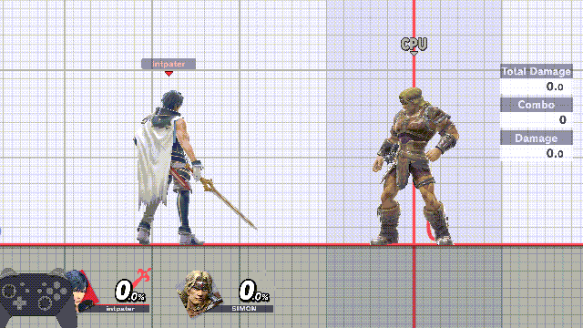
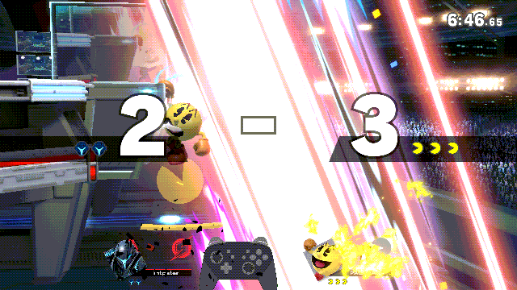

# smash-gamepad-overlay

> **Disclaimer:** this project was developed with the assistance of AI
> (Claude, Codex and other coding agents) under the operator's direction and
> review. Every claim that it works on Switch and Eden rests on the dated tests
> cited in [Status](#status); nothing is claimed beyond those records.

Rust Skyline plugin for Super Smash Bros. Ultimate that draws Player 1's
controller inputs inside the game, so a capture card records them with the
match. It polls P1's raw controller state and updates a set of hidden Smash UI
panes that a patched `info_melee/layout.arc` adds to the match HUD.



*Training mode in Eden with Training Modpack loaded (2026-10-14): the controller at the bottom left follows P1's buttons and sticks.*



*A 1v1 stock match against a CPU in Eden (2026-10-14), starting with a stock loss and respawn: the overlay sits near the bottom centre, beside P1's HUD.*

Both clips were recorded in Eden build `9a5d704c9c` with Smash 13.0.5 and
Training Modpack loaded. Cropped stills of the same scenes are in
`docs/media/gamepad-training.png` and `docs/media/gamepad-match.png`. The clips
use the optional `switch_pro_alt_builtin` skin generated from RetroSpy's
`switch-pro-alt` art; a default install shows the simpler square-pane
`default_simple` skin in the same place.

## Status

Tested and working on 2026-10-14 on both a Switch and Eden:

- **Switch:** Atmosphère 1.12.0 with hekate 6.5.4, the current Skyline
  release, ARCropolis 4.1.1, Training Modpack installed, Smash 13.0.5. Two
  online matches and Training ran in one session with the overlay loaded,
  alongside other Skyline plugins.
- **Eden:** development build `9a5d704c9c` (2026-10-14), isolated profile,
  Smash 13.0.5, with Skyline, ARCropolis and Training Modpack. The overlay
  loaded in every run that day and the game held 60 fps, in Training and in
  matches.

Both platforms ran build `c25-b17-31994bc-dirty-c702bd88435e27c6`
(NRO SHA-256 `20e9e062c9ace6230b3fadda6fb9a1ffdb76659479f3b32de0f1100e9e72a494`).
Its source is identical to commit `1bae4ee` (only `AGENTSUMMARY.md` notes
differ). It was built with the `diagnostic-pane-userdata` feature, an
observer-only probe that writes `sd:/smash-gamepad-overlay-probe.log`. Release
`v0.1.0` is the same source built with default features (probe off), so it is
not byte-identical to the tested binary.

Release `v0.1.1` is the `v0.1.0` source plus a memory pass (release profile
`opt-level = "s"`, smaller skin tables, stack buffers on the text path; see
[Memory](#memory)). It changes no hook, offset, pane name or runtime
behaviour, but its binary has not been run on a Switch or in Eden. `v0.1.0`
remains the last device-tested release.

Both tests had Training Modpack loaded, so they exercised the non-draw HUD
path. The standalone `Layout::Draw` path used without Training Modpack has not
been rechecked on 13.0.5.

The plugin is built with `cargo-skyline` 3.5.0 against the `skyline` crate
0.6.0 (`Cargo.toml` and `Cargo.lock`). Hook offsets target Smash display
version 13.0.5 only; other game versions are not supported.

## Install

You need a Switch with Atmosphère (or Eden), Skyline, ARCropolis and Smash
13.0.5. Title ID: `01006A800016E000`.

### 1. Plugin and config

Download `smash-gamepad-overlay-v0.1.1-sd.zip` from the
[latest release](https://git.syntaxbyexample.com/intpa/smash-gamepad-overlay/releases)
and extract it to the root of your SD card. It contains:

```text
atmosphere/contents/01006A800016E000/romfs/skyline/plugins/libsmash_gamepad_overlay.nro
ultimate/mods/smash-gamepad-overlay/config.json
SMASH-GAMEPAD-OVERLAY-README.txt
```

To install by hand instead, copy `libsmash_gamepad_overlay.nro` to
`sd:/atmosphere/contents/01006A800016E000/romfs/skyline/plugins/`.

For Eden, use the same paths under Eden's `sdmc` folder (for example
`~/.local/share/eden/sdmc/` on Linux).

### 2. Patched `info_melee/layout.arc` (required)

The overlay's panes live in a patched copy of the game's match HUD layout.
That file is derived from Nintendo's data, so it is not shipped. Generate it
from your own `data.arc` dump with the repository's Rust installer. You need
Git and Rust 1.96 or newer:

```sh
git clone https://git.syntaxbyexample.com/intpa/smash-gamepad-overlay
cd smash-gamepad-overlay
git checkout v0.1.1
git clone https://github.com/crashbandicode/Toolbox-Cli local-checkouts/Toolbox-Cli
cargo run --release --manifest-path tools/sgpo_installer/Cargo.toml -- \
  --data-arc /path/to/your/data.arc \
  --sd-zip sgpo-layout.zip \
  --no-sd-stage --skip-nro --force
```

Extract `sgpo-layout.zip` to the root of your SD card. It adds:

```text
ultimate/mods/smash-gamepad-overlay/ui/layout/info/info_melee/info_melee/layout.arc
ultimate/mods/smash-gamepad-overlay/config.json
```

ARCropolis loads the layout as a normal data replacement. If you already
extracted `ui/layout/info/info_melee/info_melee/layout.arc` yourself, pass
`--layout-arc /path/to/layout.arc` instead of `--data-arc`. The installer run
above was checked on Linux on 2026-10-14; other host systems were not tested.

Without the patched layout, the normal draw path falls back to `DebugText`,
and with Training Modpack loaded the overlay stays inactive and logs the
missing panes.

### 3. Training Modpack

Training Modpack is supported. When the plugin sees Training Modpack it skips
its own `Layout::Draw` hook and uses a non-draw HUD path instead; that path
needs the patched layout from step 2. The overlay shows in Training and in
normal matches. To hide it only in Training mode, create this empty file:

```text
sd:/ultimate/mods/smash-gamepad-overlay/HIDE_TRAINING_GAMEPAD
```

## Runtime Skin Config

The plugin reads an optional config at startup and again at each match start
(not every frame):

```text
sd:/ultimate/mods/smash-gamepad-overlay/config.json
```

```json
{
  "active_skin": "auto",
  "default_skins": {
    "switch": "default_simple",
    "gamecube": "default_simple_gamecube"
  }
}
```

If the file is missing, unreadable, malformed, or names an unknown skin, the
plugin falls back to `default_simple`.

With `active_skin` set to `auto`, the skin follows P1's controller family:
Switch, Pro Controller, Joy-Con and handheld use `default_skins.switch`;
GameCube controllers use `default_skins.gamecube`. The skin can change during
a match if P1's controller family changes. To pin one skin, set `active_skin`
to one built-in name and start a new match.

Built-in skin names:

- `default_simple`: square-pane Switch/Pro/Joy-Con skin.
- `default_simple_gamecube`: the same panes with non-GameCube controls omitted.
- `minimal_debug`: compatibility alias for `default_simple`.
- `switch_pro_alt_builtin`: generated from RetroSpy's `switch-pro-alt` skin.
  Renders only if the installed layout has the matching `sgpo_alt_*` panes.
- `gamecube_tron_builtin`: generated from RetroSpy's `gamecube-tron` skin.
  Renders only if the installed layout has the matching `sgpo_gct_*` panes.

The two RetroSpy-based skins need RetroSpy's skin folders when you generate the
layout; see [Optional RetroSpy skins](#optional-retrospy-skins).

## Training Modpack Details

Training Modpack hooks `Layout::Draw`, so this plugin does not. Compatibility
mode turns on when the plugin finds the standard Training Modpack NRO path, any
`*training*modpack*.nro` in the Skyline plugin folder, or this force flag:

```text
sd:/ultimate/mods/smash-gamepad-overlay/FORCE_TRAINING_MODPACK_COMPAT
```

In this mode the plugin captures P1's HUD parts layout from the HUD info-alpha
hook and drives live input updates from the scene-update hook. Cached panes are
tracked through guarded `Pane::Finalize` and `Layout::Finalize` observers so a
pane is forgotten when the game frees it.

## Runtime Log

The plugin writes a small diagnostic log to `sd:/smash-gamepad-overlay.log`
(for Eden, `<eden>/sdmc/smash-gamepad-overlay.log`). It records startup, the
build ID, the Smash display version, hook resolution, the HUD capture/update
status and the active display path. This is useful when `cargo skyline listen`
shows nothing.

If Training Modpack is loaded and the log says `could not find ... sgpo_root`,
Smash is loading an unpatched `info_melee` layout. Regenerate and reinstall it
(step 2 of [Install](#install)).

## Known Limitations

- Smash 13.0.5 only. The draw path and offsets are gated to that version.
- The visual skins are rough programmer art made of cloned picture panes.
- With Training Modpack the overlay lives in P1's HUD parts layout, so it
  cannot reach the bottom-right corner without clipping. Training mode uses a
  separate left-side placement to stay clear of the CPU's HUD.
- A dropped layout can keep its last alpha until the game finalizes its panes.
- A results-to-CSS crash seen once on Switch during the 2026-10-06
  investigation has no proven root cause. The pane lifetime fix in this
  version addresses a different, proven fault and is not claimed to fix it.

## Build From Source

Requirements: a Rust toolchain set up for Skyline, `cargo-skyline`, and for the
installer a checkout of [Toolbox-Cli](https://github.com/crashbandicode/Toolbox-Cli)
at `local-checkouts/Toolbox-Cli` (a path dependency until `nx-layout-toolbox`
is published as a crate).

```sh
cargo skyline check
cargo skyline build --release
```

The NRO is written to
`target/aarch64-skyline-switch/release/libsmash_gamepad_overlay.nro`.

Runtime logs include a build ID such as `c26-b3-1234abc`. `c26` comes from
`git rev-list --count HEAD`, `b3` is a local build counter under `target/`
(reset by `cargo clean`), and a `-dirty-<hash>` suffix marks a build from an
uncommitted tree. `SMASH_GAMEPAD_OVERLAY_BUILD_ID` overrides the whole ID.

The host-testable cache metadata crate has its own tests:

```sh
cargo test --manifest-path crates/sgpo-ui-cache-metadata/Cargo.toml
```

Host `cargo clippy` on the plugin crate itself fails on stable Rust because
`nnsdk` uses `#![feature]`; use `cargo skyline clippy` instead.

### Memory

The plugin is mapped into the game's memory for the whole session, so the
release profile favours size: `opt-level = "s"` with fat LTO and
`panic = "abort"`. Measured on the aarch64 ELF with the same fixed build ID
(`readelf -S`; NRO size from the file):

| build | `.text` | `.rodata` | `.data` | `.bss` | `.rela.dyn` | NRO |
| --- | ---: | ---: | ---: | ---: | ---: | ---: |
| v0.1.0 (`opt-level = 3`) | 87744 | 22032 | 13296 | 4016 | 8544 | 143360 |
| v0.1.0 code, `opt-level = "s"` | 63952 | 21912 | 13304 | 4048 | 8496 | 118784 |
| v0.1.1 code, `opt-level = 3` | 89984 | 21592 | 10936 | 4016 | 7776 | 139264 |
| v0.1.1 (`opt-level = "s"`) | 64544 | 21496 | 10944 | 4048 | 7728 | 114688 |

Besides the profile, v0.1.1 drops the two converter-only name fields from
every `SkinElement` (the tables lose 2352 bytes of `.data` and 34 dynamic
relocations), formats `DebugText` lines into fixed 256-byte stack buffers
instead of `String`s, and passes text to `set_text_string` from a stack buffer
instead of a `CString`. In Visual mode the per-frame paths already allocated
nothing; the text fallback now allocates nothing per frame either.

### Layout generation with a local `.env`

With `.env` configured (copy `.env.example`), the installer reads
`SGPO_DATA_ARC` and `SGPO_SD_ROOT`, generates the layout, writes
`config.json`, backs up any existing layout/config/NRO, and stages the NRO
from `target/` to the SD root:

```sh
cargo run --manifest-path tools/sgpo_installer/Cargo.toml -- --force
```

Explicit inputs, including the NRO to stage:

```sh
cargo run --manifest-path tools/sgpo_installer/Cargo.toml -- \
  --sd-root /path/to/sdmc \
  --data-arc /path/to/data.arc \
  --nro target/aarch64-skyline-switch/release/libsmash_gamepad_overlay.nro \
  --force
```

Add `--sd-zip <file> --no-sd-stage` to write an SD-root ZIP (NRO, layout and
config) instead of copying to an SD root.

The patcher adds a hidden `sgpo_root` with 24 visual panes to the root
`info_melee` layout and to both player HUD parts layouts. The root panes serve
the normal draw path; the player-parts panes serve the Training Modpack path.
The layout notes in `docs/` were taken from a 13.0.4 dump; the 13.0.5 change
was a code-offset update.

The older Python scripts (`tools/patch_info_melee_layout.py`,
`tools/stage_arcropolis_layout.py`) remain as reference tooling. See
`docs/release-bundle-strategy.md` for the bundle plan.

### Optional RetroSpy skins

```sh
cargo run --manifest-path tools/sgpo_installer/Cargo.toml -- --force --include-all-presets
```

This builds `switch_pro_alt_builtin` and `gamecube_tron_builtin` into the same
layout. Point `--switch-pro-alt-dir` and `--gamecube-tron-dir` at RetroSpy's
`skins/switch-pro-alt` and `skins/gamecube-tron` folders. Generated textures
default to `--texture-format bc7-srgb`; `rgba8-srgb` is available for
diagnosing compression artifacts at the cost of a larger layout.

## Skin Model

The renderer is skin-driven. It does not create or decode PNGs at runtime.
Each skin is a Rust table of `SkinElement` entries that map a logical
`ControlId` to an existing named Smash UI pane, with base position, size,
released/pressed alpha and scale, and an optional stick movement range. Heavy
work (PNG conversion, texture packing, pane injection) happens on the PC before
runtime. See [Skin Converter Notes](docs/skin-converter-notes.md).

## Agent Use

- `AGENTS.md`: project instructions for coding agents.
- `CLAUDE.md`: Claude Code entry point.
- `AGENTSUMMARY.md`: current-state handoff; update it when hooks, offsets,
  asset workflow or next steps change.
- `sgpo-handoff.mdc`: portable Cursor rule; copy it to
  `.cursor/rules/sgpo-handoff.mdc` to use it.

## Validation

Before using a build as a new baseline, run the
[Alpha Validation Checklist](docs/alpha-validation-checklist.md).

## Project Constraints

Rust only. The overlay must render inside Smash so a capture card records it:
no PC overlay, OBS/browser source, network streaming, RetroSpy hardware or
external receiver. Do not commit or publish Nintendo assets: `data.arc`,
extracted BFLYT/BFLAN/BNTX files, textures, or generated `layout.arc` files.
