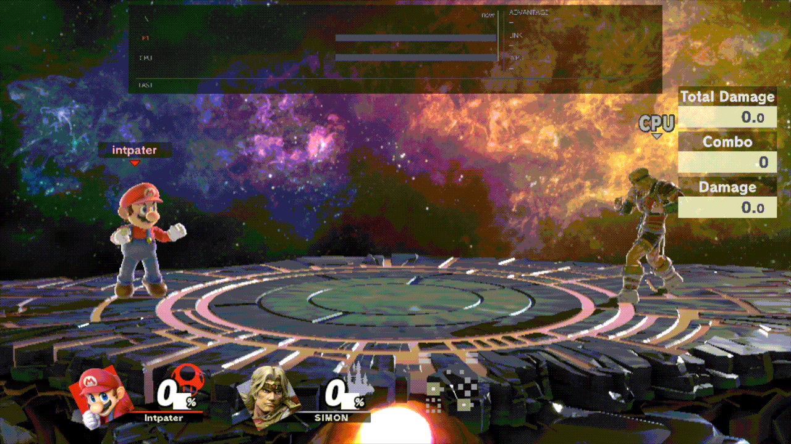
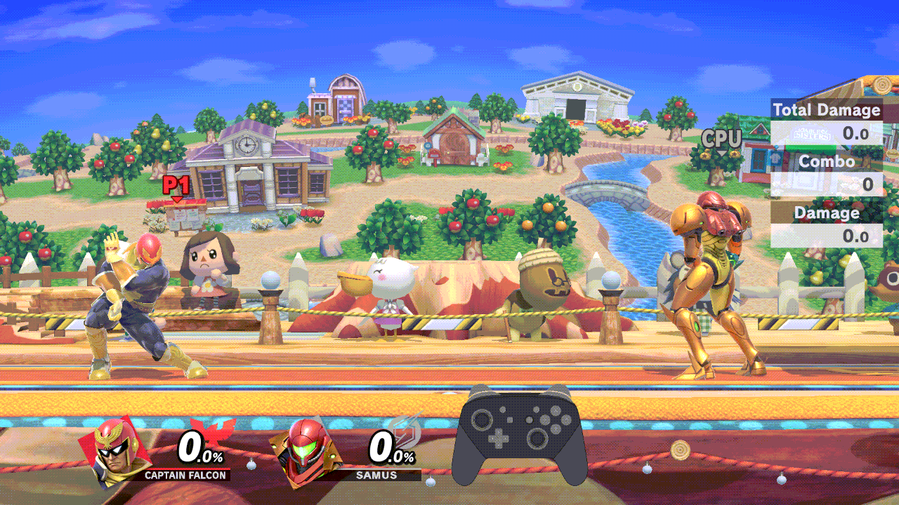
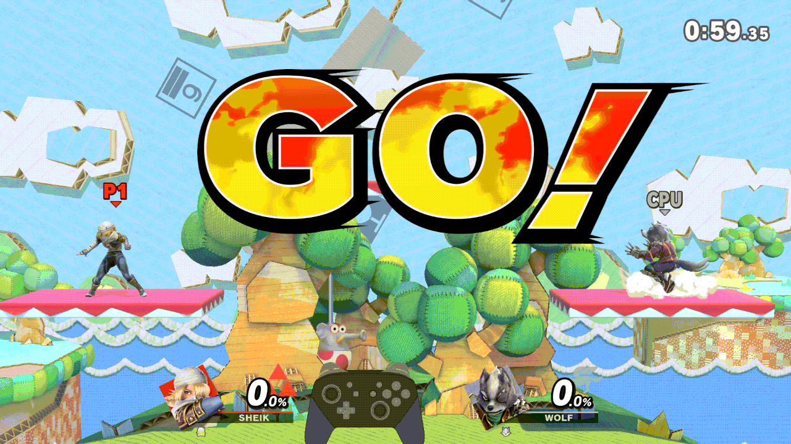

# smash-gamepad-overlay

> **Disclaimer:** this project was developed with the assistance of AI
> (Claude, Codex and other coding agents) under the operator's direction and
> review. Every claim that it works on Switch and Eden rests on the dated tests
> cited in [docs/STATUS.md](docs/STATUS.md); nothing is claimed beyond those
> records.

A Skyline plugin for Super Smash Bros. Ultimate 13.0.5 that draws Player 1's
controller inside the game's HUD, so a capture card records it with the match.
It shows the buttons and sticks the game received for P1, on that player's own
button layout, so inputs another plugin writes for P1 (a CPU pilot) show too.
Since v0.4.0 it is a single NRO: no patched layout file is needed.



*Training in Eden, 2026-11-17, the v0.4.0 release NRO (`305ca4e7…`) alone with
no `layout.arc`, beside TrainingRooms (`458c0636`) and a test HUD mod that
changes the same `info_melee` layout (its damage decimals are solid blocks):
both changes show. 6.6 s.*


*Training in Eden, 2026-11-13, the v0.3.1 release NRO (`5ab98bdf…`) with the
`switch_pro_alt_builtin` skin config and a patched layout that has the RetroSpy
skins: the controller sits to the right of the CPU's HUD and follows P1's
buttons and sticks. Online Deluxe 0.10.5, Legal Stages + Counterpick and the
tile cursor were also loaded; none of them draws here.*



*A 1v1 stock match against a level 9 CPU in Eden, 2026-11-13, the v0.3.1 release NRO (`5ab98bdf…`) with the
`switch_pro_alt_builtin` skin config: the controller sits at the bottom centre, beside P1's HUD. 7.2 s from
the countdown's GO!, one cut, 10 fps (15 fps did not fit in 15 MB on this busy stage). Online Deluxe 0.10.5,
Legal Stages + Counterpick and the tile cursor were also loaded; none of them draws here.*

## Status

- **Latest release:** v0.4.0 (2026-11-17): only the NRO, no `layout.arc`.
  Tested in Eden on 2026-11-17, alone, with TrainingRooms and a HUD mod, and
  with an old patched layout still installed; **not yet tested on a Switch**.
  How it works: [docs/NRO-ONLY-DESIGN.md](docs/NRO-ONLY-DESIGN.md).
- **On the operator's Switch:** v0.3.1 since 2026-11-05; no console log of it
  has been read back yet. The last release with a recorded console test is
  v0.1.2 (2026-10-18).
- Details and the history of every release: [docs/STATUS.md](docs/STATUS.md).

## Install

You need a Switch with Atmosphère (or Eden), Skyline, ARCropolis and Smash
13.0.5 (title ID `01006A800016E000`).

### 1. Install just the NRO

Download `libsmash_gamepad_overlay.nro` from the
[latest release](https://git.syntaxbyexample.com/intpa/smash-gamepad-overlay/releases)
and copy it to:

```text
sd:/atmosphere/contents/01006A800016E000/romfs/skyline/plugins/libsmash_gamepad_overlay.nro
```

That is all: **no `layout.arc` is needed** since v0.4.0. When the game loads
its match HUD layout, the plugin adds its own panes to that layout through
ARCropolis, so a HUD mod that changes the same layout keeps working with it.
For Eden, use the same path under Eden's `sdmc` folder.

**Upgrading from v0.3.x:** replace the NRO. You may delete the old
`ultimate/mods/smash-gamepad-overlay/ui/` folder (the patched layout); if you
keep it, the plugin sees its panes already there and leaves it as it is. Your
`config.json` keeps working.

### 2. RetroSpy skins (optional)

The default square skins need nothing else. The two textured skins drawn from
RetroSpy art (`switch_pro_alt_builtin`, `gamecube_tron_builtin`) still need
the patched layout from the installer in this repository, built from your
own `data.arc` dump (Git and Rust 1.96 or newer):

```sh
git clone https://git.syntaxbyexample.com/intpa/smash-gamepad-overlay
cd smash-gamepad-overlay
git checkout v0.4.0
git clone https://github.com/crashbandicode/Toolbox-Cli local-checkouts/Toolbox-Cli
cargo run --release --manifest-path tools/sgpo_installer/Cargo.toml -- \
  --data-arc /path/to/your/data.arc --include-all-presets \
  --sd-zip sgpo-layout.zip --no-sd-stage --skip-nro --force
```

Extract `sgpo-layout.zip` to the root of your SD card. Like every
`layout.arc` mod, that file replaces the whole match HUD layout, so it does
not combine with another HUD mod.
### 3. Hiding it in Training

The overlay shows in Training and in normal matches. To hide it only in
Training, create this empty file:

```text
sd:/ultimate/mods/smash-gamepad-overlay/HIDE_TRAINING_GAMEPAD
```

Skins, the config file and the log are described in
[docs/TECHNICAL.md](docs/TECHNICAL.md).

## Limits

- Smash 13.0.5 only.
- It does not show in a lobby's waiting-room practice (Local Wireless or
  online rooms): the game draws a different HUD there.
- The skins are simple programmer art.
- A results-to-character-select crash seen once on a Switch on 2026-10-06 has
  no known cause.

## Build

```sh
cargo skyline build --release
```

The NRO is written to
`target/aarch64-skyline-switch/release/libsmash_gamepad_overlay.nro`. The
installer needs a checkout of
[Toolbox-Cli](https://github.com/crashbandicode/Toolbox-Cli) at
`local-checkouts/Toolbox-Cli`. Tests, build IDs and memory figures:
[docs/TECHNICAL.md](docs/TECHNICAL.md).

## License

MIT ([LICENSE](LICENSE)).
